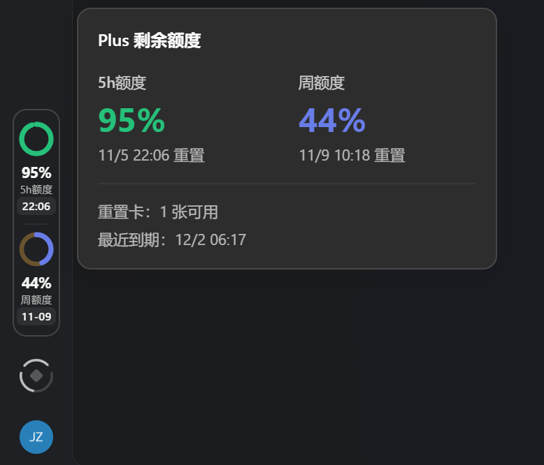

# Codex Usage Card

在 Codex 桌面客户端侧栏显示剩余额度。根据账号支持的额度窗口，显示五小时和周额度圆环。五小时下方显示重置时分（如 `18:30`），周额度下方显示重置日期（如 `11-10`），均按电脑本地时区换算。悬停或用键盘聚焦可查看完整重置信息。

## 效果图



## 安装

先安装并登录对应平台的 Codex 桌面客户端，再从本仓库的 [Releases](https://github.com/Icodezhan/codex-usage-card/releases) 下载适合的 ZIP 和同名 `.zip.sha256` 文件。

### Windows 10/11 x64

1. 从 [Windows `0.9.4-windows.15` 发布页](https://github.com/Icodezhan/codex-usage-card/releases/tag/v0.9.4-windows.15) 下载 `CodexUsageCard-Windows-0.9.4-windows.15-x64.zip`。安装包内置 Node.js 24.14.1。
2. 在下载目录运行以下 PowerShell 命令，对照 `.zip.sha256` 文件中的哈希值。确认一致后完整解压 ZIP。

   ```powershell
   Get-FileHash -Algorithm SHA256 -LiteralPath '.\CodexUsageCard-Windows-0.9.4-windows.15-x64.zip'
   ```

3. 双击解压目录中的 `Install.cmd`，等待安装成功。
4. 保存工作并完全退出 Codex。若系统托盘仍有 Codex 图标，也从托盘退出。
5. 双击桌面 **Codex Usage Card** 快捷方式启动 Codex。后续也使用这个快捷方式加载额度卡。

解压目录中的 `Diagnose.cmd` 用于诊断，`Uninstall.cmd` 用于卸载额度卡。更多安装和排查说明见 [Windows 使用指南](https://github.com/Icodezhan/codex-usage-card/blob/windows/docs/windows.md)。

### macOS

1. 从 [macOS `0.9.5-macos.1` 发布页](https://github.com/Icodezhan/codex-usage-card/releases/tag/v0.9.5-macos.1) 下载 `CodexUsageCard-macOS-0.9.5-macos.1.zip`。此版本已正式发布，并通过用户的 Mac 实机验证。
2. 在下载目录运行以下命令，对照 `.zip.sha256` 文件中的哈希值。确认一致后完整解压 ZIP。

   ```bash
   shasum -a 256 CodexUsageCard-macOS-0.9.5-macos.1.zip
   ```

3. 运行解压目录中的 `安装.command`。安装器会查找 Node.js 24 或更新版本，包括 Codex 自带运行时。也可以在解压目录执行以下命令。

   ```bash
   node manage.cjs install
   ```

4. 保存工作后用 **⌘Q** 完全退出 Codex，再从 Dock 或“应用程序”里的**原 Codex 图标**打开。满足启动保护条件时，助手可能会有序重新打开 Codex 一次，以建立额度卡需要的本地连接。

可以用 `node manage.cjs status` 查看状态，或用 `node manage.cjs uninstall` 卸载额度卡。原生启动助手使用 ad-hoc 签名，尚未通过 Apple 公证。启动和诊断问题也可参考[上游 macOS 排查指南（v0.9.4）](docs/macos.md)。

## 分支与打包

- [`windows`](https://github.com/Icodezhan/codex-usage-card/tree/windows) 维护 Windows 版。构建流程见 [Windows 维护指南](https://github.com/Icodezhan/codex-usage-card/blob/windows/docs/windows-maintenance.md)。
- [`macos`](https://github.com/Icodezhan/codex-usage-card/tree/macos) 维护 macOS 版。在该分支下载 [上游 v0.9.5 Beta 的原始 ZIP](https://github.com/Lorie7813/codex-usage-card/releases/tag/v0.9.5-beta.1)，用 Python 3.9 或更新版本执行 `python3 scripts/package_macos.py /path/to/CodexUsageCard-macOS-0.9.5.zip`，生成的安装包位于 `dist/`。

## 安全与许可

额度卡从本机 Codex CLI 读取剩余额度，并使用本机回环调试端口将卡片显示在侧栏。请勿将该端口转发或开放给其他设备。客户端更新后，内部接口变化可能影响兼容性。详见 [安全说明](SECURITY.md)。

本项目是非官方插件，源自 [Lorie7813/codex-usage-card](https://github.com/Lorie7813/codex-usage-card)，重置标签参考 [NANAiiiii 的 Windows fork](https://github.com/NANAiiiii/codex-usage-card)。保留原项目版权及 [MIT 许可证](LICENSE)。

## English quick start

Codex Usage Card adds remaining quota rings and local reset times to the Codex desktop sidebar. Choose your platform ZIP from [Releases](https://github.com/Icodezhan/codex-usage-card/releases), verify it against the accompanying `.zip.sha256` file, and extract the entire archive.

- On **Windows x64**, run `Install.cmd`, quit Codex including its tray instance, then launch it using the **Codex Usage Card** desktop shortcut.
- On **macOS**, run `安装.command` or `node manage.cjs install` with Node.js 24 or later. Quit Codex with **⌘Q** and reopen it from its original icon. This release has been verified by a user on a Mac.
